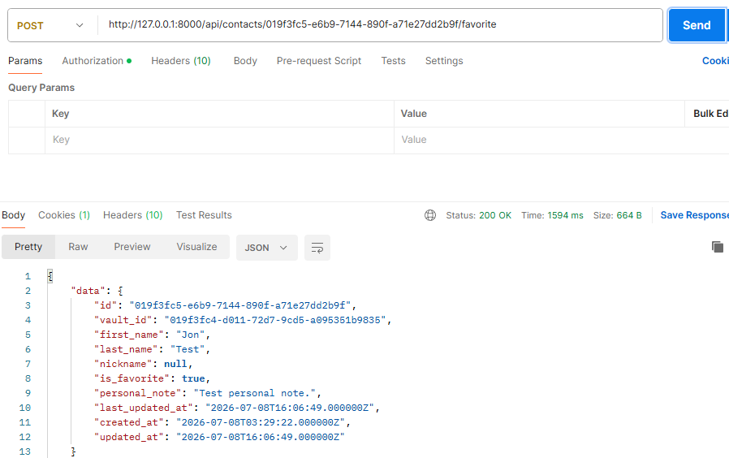
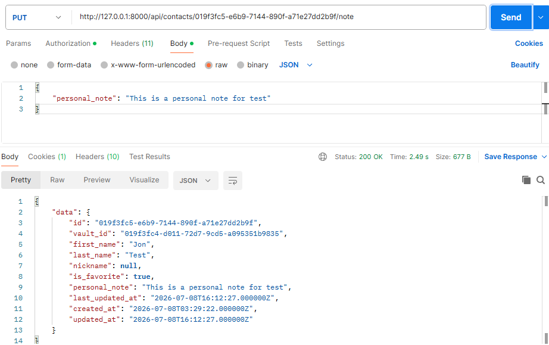

# Monica Personal CRM - Contact API Enhancement

This repository is an extension of the official `monicahq/monica` project, used exclusively to develop the **`contact-feature`** branch.

### Local Setup

**1. Clone the main repository & enter directory:**

```bash
git clone https://github.com/monicahq/monica.git && cd monica
```

**2. Add the feature remote tracking point:**

```bash
git remote add contact-feature-remote https://github.com/arifulhaque-ah/monica.git && git fetch contact-feature-remote contact-feature
```

**3. Switch to the feature branch tracking the remote:**

```bash
git checkout -b contact-feature contact-feature-remote/contact-feature
```

### Next Steps

For database configurations, dependency installations, and runtime steps, please follow the **[Official Monica Installation Guide](https://github.com/monicahq/monica.git)**.

## Implementation Approach

The implementation follows Monica's existing Laravel structure.
Main changes include:

- Contact API controller
- Contact API resource
- Database migration for contact fields
- Updated API routes
- Tests for the implemented behavior
  Changed files are located in the `/changes.txt` directory.

## Assumptions

- Existing Monica authentication and authorization remain unchanged.
- No new third-party dependencies are required.
- Default test data is loaded using `php artisan db:seed`.

## Limitations and Trade-offs

- This repository does not include the full Monica source code.
- The changes need to be copied into a Monica checkout before running.
- UI changes were not included.
- More validation and optimization can be added later if needed.

## Feature Tests

Feature tests cover contact behavior.

|                                   Mark a contact as favorite                                    |                                     Update a personal note for a contact                                      |                                       Filter contacts using `favorite=1`                                        |
| :---------------------------------------------------------------------------------------------: | :-----------------------------------------------------------------------------------------------------------: | :-------------------------------------------------------------------------------------------------------------: |
|  |  |  |

## Estimated Time Spent

Estimated time spent: ~ 8 hours.
